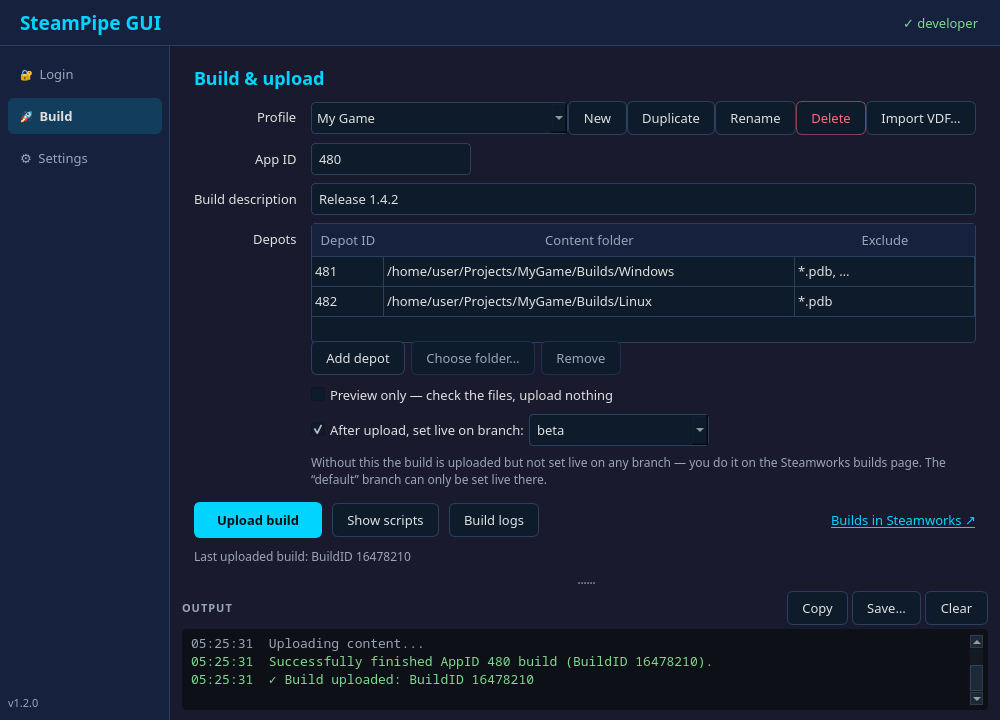
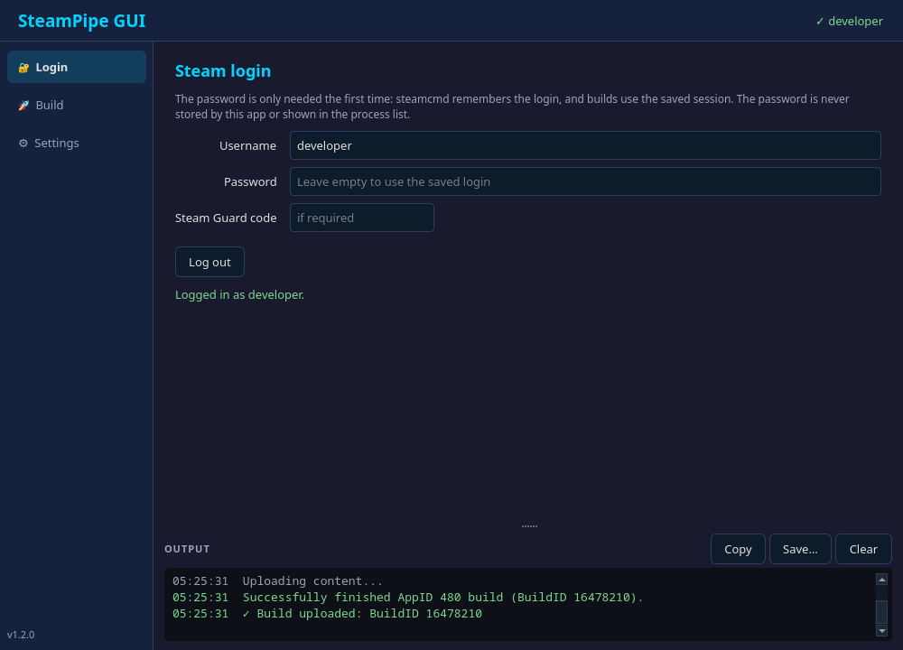
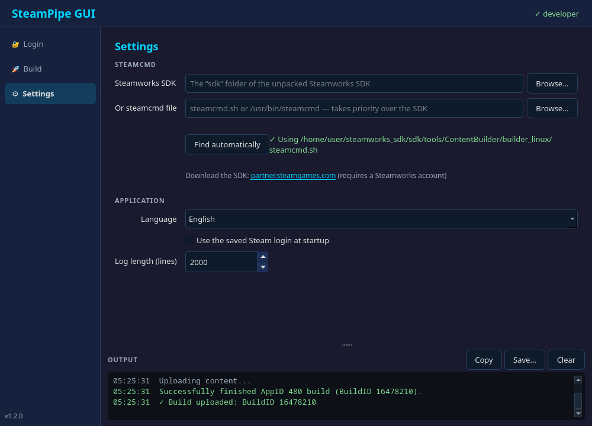

# SteamPipe GUI for Linux

A native Linux GUI for uploading game builds to Steam through SteamPipe (`steamcmd`).
Written in Python + PyQt6.


---



| Login | Settings |
|---|---|
|  |  |

## Features

- **Profiles** — one profile per game: App ID, depots, branch and description are remembered separately.
- **Several depots per build**, each with its own content folder and file exclusions (`*.pdb` by default).
- **Import existing scripts** — create a profile from an `app_build_*.vdf` (e.g. `ContentBuilder/scripts` of the SDK,
  including scripts written by the Windows SteamPipe GUI; `Z:\…` Wine paths are converted automatically).
- **Preview builds** — scan the content and write a manifest without uploading anything.
- **Set live on a beta branch** after upload, with a warning that `default` can only be set live in Steamworks.
- **Safe login** — the password is only needed the first time; steamcmd keeps the session and builds reuse it.
  The password is never stored and never appears in the process list. Steam Guard codes and mobile
  confirmations are asked for when steamcmd needs them.
- **Progress and Cancel** for uploads, clear success/failure result with the BuildID and a link to the
  Steamworks builds page.
- **Script preview** — see the exact VDF files that will be passed to steamcmd.
- Colored log with copy / save, configurable length.
- 12 languages: English, Русский, Українська, Deutsch, Français, Español, Português, Polski, 日本語,
  简体中文, 繁體中文, 한국어. Any `locales/<code>.json` file adds a language.
- Equestria OS character themes when `equestria-qt-kit` is installed,
  built-in dark theme otherwise.

## Requirements

- Linux, Python 3.11+, PyQt6
- `steamcmd`: the Steamworks SDK (`tools/ContentBuilder/builder_linux/steamcmd.sh`) or the `steamcmd` package
- A Steam account with developer access to the app (Steamworks partner)

## Installation

### Arch Linux (AUR)

```bash
yay -S steampipe-gui
```

### From source

```bash
git clone https://github.com/Lucia7Lunadottir/SteamPipeGUI-Linux.git
cd SteamPipeGUI-Linux/steam-pipe-gui
python3 main.py
```

## Usage

1. **Settings** — point to the `sdk` folder of the unpacked
   [Steamworks SDK](https://partner.steamgames.com/downloads/steamworks_sdk.zip), or to a `steamcmd` file.
   “Find automatically” checks the usual places.
2. **Login** — enter your Steam username and password (and a Steam Guard code if needed).
   Next time leave the password empty: the saved session is used.
3. **Build** — choose or create a profile, enter the App ID, add depots (the depot ID defaults to App ID + 1)
   and their content folders, then press **Upload build**.

Build logs and manifests are written to `ContentBuilder/output` of the SDK
(or `~/.cache/steampipe-gui/output` when steamcmd is not from the SDK).
Settings are stored in `~/.config/SteamPipeGUI/config.json`.

## License

GPL-3.0-only
